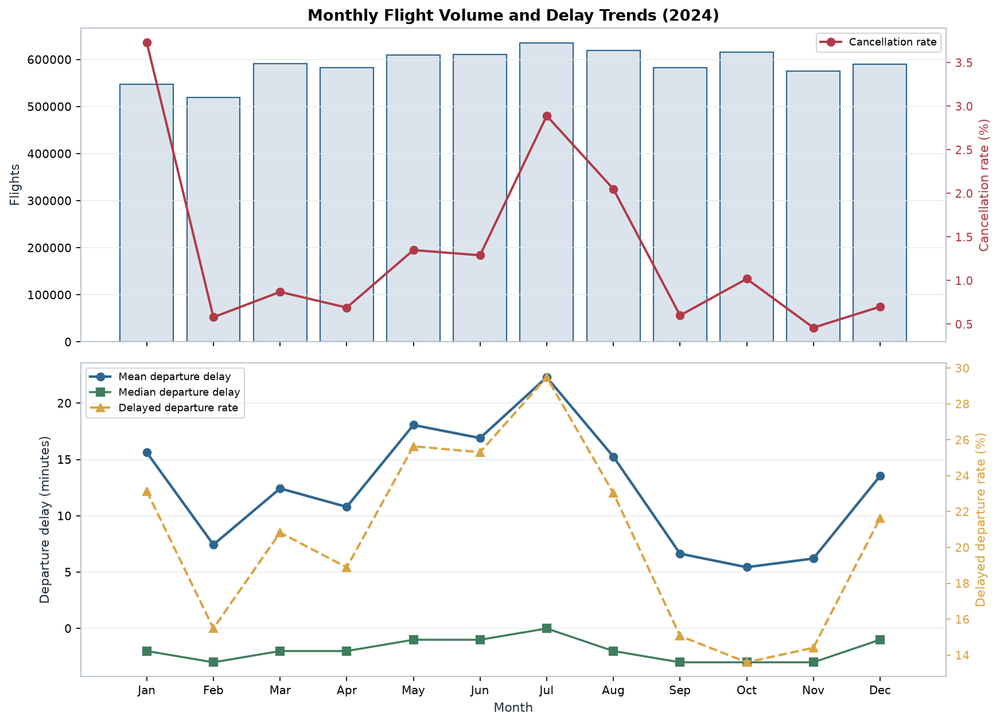
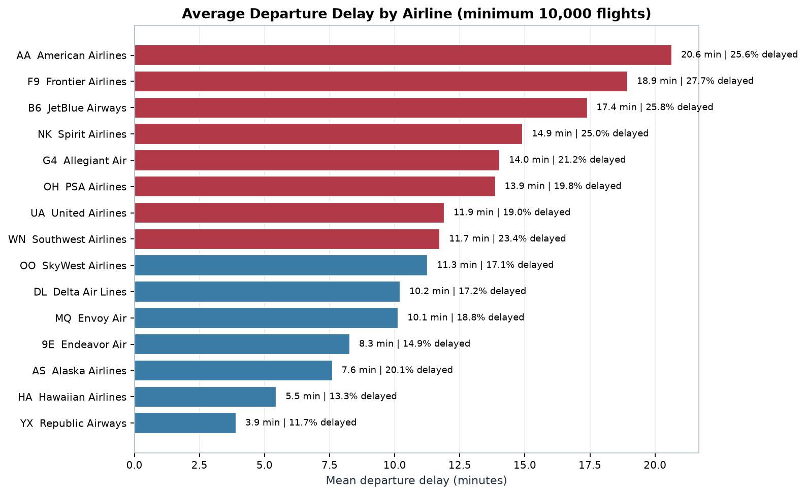
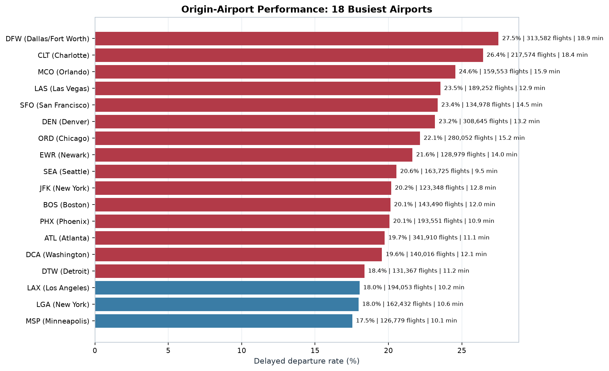
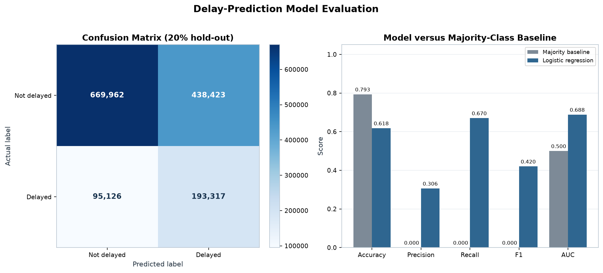

# 2024 Airline Delay and Cancellation Analytics

## A Spark-Based Descriptive and Predictive Study

---

## Abstract

This report analyzes 7,079,081 flight records from the 2024
`flight_data_2024.csv` file using Apache Spark 4.2.0 on a single Windows
workstation. The objectives are to quantify departure and arrival delays,
compare airlines, airports, routes, months, days, and hours, explain
cancellations and attributed delay minutes, and test whether a leakage-safe
Spark MLlib model can identify delayed departures.

The file covers 366 days, 15 operating carriers, 348 origin airports, 348
destination airports, and 6,805 routes. There are 96,315 cancellations
(1.3606%), 17,499 diversions (0.2472%), and 1,441,139 delayed departures of at
least 15 minutes (20.6385% of 6,982,766 flown flights). The mean departure delay
is 12.6451 minutes, but the median is -2 minutes and the 99th percentile is 216
minutes, showing a strongly right-skewed distribution. July is the busiest and
most delayed month; delay risk rises from 7.68% at 06:00 to 32.05% at 20:00.
Among airlines with at least 10,000 flights, F9 has the highest delayed-
departure rate (27.68%) and YX the lowest (11.68%). Weather accounts for 55.66%
of cancellations, while late aircraft (43.61%) and carrier (36.38%) account for
79.99% of attributed delay minutes. A logistic-regression model reaches AUC
0.6884 and F1 0.4202, with 67.02% recall at 30.60% precision. The results are
descriptive rather than causal, and the report documents data-quality,
methodological, and deployment limitations.

**Keywords:** airline delays, cancellations, Apache Spark, Spark SQL, PySpark,
logistic regression, operational analytics.

---

## 1. Introduction

Flight delays and cancellations impose costs on passengers, airlines, airports,
and the wider economy. A single delayed aircraft can propagate disruption through
later rotations, and a small number of extreme delays can account for a large
share of total delay minutes. Understanding where and when disruption
concentrates is therefore more useful than reporting a single national average.

This project asks five questions:

1. What is the overall scale of delay, cancellation, and diversion in the 2024
   file?
2. How do outcomes differ by airline, airport, route, month, day, and scheduled
   hour?
3. What reasons are recorded for cancellations and attributed delay minutes?
4. How concentrated is delay in the tail, and are the conclusions sensitive to
   extreme values?
5. Can a leakage-safe Spark MLlib model provide useful delay screening?

The analysis is deliberately descriptive and predictive, not causal. The dataset
contains operational records but not weather measurements, crew schedules,
maintenance logs, passenger counts, or airport-capacity data. The report
therefore distinguishes observed associations from causal claims.

---

## 2. Data

### 2.1 Source and scale

| Item | Value |
|---|---|
| File | `flight_data_2024.csv` |
| Size | 1,309,010,752 bytes (1.22 GiB) |
| Rows | 7,079,081 |
| Columns | 35 |
| Date range | 2024-01-01 to 2024-12-31 |
| Calendar days | 366 |
| Exact duplicates | 0 |
| Operating carriers | 15 |
| Origin airports | 348 |
| Destination airports | 348 |
| Routes | 6,805 |
| SHA-256 | `9456ed0695855469cf4c07f8c0b2365a93339ae841b100d9612ea842090670c0` |

The source is a BTS-format airline on-time performance extract. The file is read
with an explicit schema; Spark does not infer column types from the CSV. The
source file is never modified, and its SHA-256 hash is verified at the end of the
notebook.

### 2.2 Fields

The 35 fields fall into six groups:

- **Date and time:** `year`, `month`, `day_of_month`, `day_of_week`, `fl_date`,
  `crs_dep_time`, `dep_time`, `crs_arr_time`, `arr_time`.
- **Airline and flight identifiers:** `op_unique_carrier`, `op_carrier_fl_num`.
- **Airport and geography:** `origin`, `origin_city_name`, `origin_state_nm`,
  `dest`, `dest_city_name`, `dest_state_nm`, `distance`.
- **Operational timings:** `taxi_out`, `wheels_off`, `wheels_on`, `taxi_in`,
  `crs_elapsed_time`, `actual_elapsed_time`, `air_time`.
- **Outcomes:** `dep_delay`, `arr_delay`, `cancelled`, `cancellation_code`,
  `diverted`.
- **Delay causes:** `carrier_delay`, `weather_delay`, `nas_delay`,
  `security_delay`, `late_aircraft_delay`.

### 2.3 Data quality

The profile contains one invalid scheduled departure time, one null scheduled
elapsed time, and one negative scheduled elapsed time. These are retained but
excluded from the relevant derived calculations. There are no exact duplicate
rows and no invalid month, day, distance, cancellation, or diversion flags.

The 20-check quality summary records 3,345 cancelled flights with a recorded
departure delay. These are excluded from departure-delay denominators so that
cancellations are not treated as on-time flights. There are 92,970 missing
departure delays (1.3133%) and 113,814 missing arrival delays (1.6078%); missing
values are not imputed as zero.

The five delay-cause fields are zero-filled when attribution is unavailable.
Cause analysis therefore requires a positive attributed total and covers
1,155,299 of 1,441,139 delayed departures (80.1657%). The remaining 285,840
delayed departures are retained in delay KPIs but excluded from cause shares.

A detailed schema and the complete quality table are in
`results_analysis/dataset_profile/dataset_profile.md`.

---

## 3. Methodology

### 3.1 Architecture

The project uses a local, single-machine Spark session:

| Setting | Value |
|---|---|
| Spark master | `local[8]` |
| PySpark | 4.2.0 |
| Java | 21.0.1 |
| Driver / executor memory | 6 GB / 6 GB |
| Shuffle partitions | 64 |
| Adaptive query execution | Enabled |
| Spark UI | Disabled |
| Serializer | Kryo |
| Arrow | Disabled |

Input is the CSV directly. Outputs are small aggregated CSV tables and PNG
figures. No Hadoop, HDFS, Hive, Kafka, Delta Lake, cloud service, or database
server is used. Spark runs in a local process with eight threads.

### 3.2 Cleaning and derived fields

The cleaned DataFrame retains all 7,079,081 rows. Exact duplicates would be
removed only if present; none were found. Derived fields support denominators
and grouping:

- `is_cancelled`, `is_diverted`, `is_flown`.
- `dep_delay_valid`: not cancelled and departure delay observed.
- `arr_delay_valid`: not cancelled, not diverted, and arrival delay observed.
- `dep_delayed` / `arr_delayed`: 1 at the 15-minute threshold, 0 below it, null
  when the delay is not valid.
- `delay_risk`: on-time/early (<15), minor (15-29), moderate (30-59), severe
  (60-119), extreme (120+).
- `distance_band`: <250, 250-499, 500-999, 1,000-1,499, 1,500+ miles.
- `cause_available`: valid delayed departure with positive attributed minutes.
- `route`, `carrier_name`, `cancellation_reason`, `month_name`, `day_name`,
  `sched_dep_hour`, `dep_hour`, `quarter`.

The full definition table and denominator rules are in
`results_analysis/detailed_analysis/data_cleaning_report.md`.

### 3.3 Analytical queries

Fourteen Spark SQL queries run against the temporary view `flights_clean`:

| ID | Analysis |
|---|---|
| Q01 | Overall flight, delay, cancellation, and diversion statistics |
| Q02 | Airline flight volume and share |
| Q03 | Airline performance with >= 10,000 flights |
| Q04 | Monthly volume and delay trends |
| Q05 | Day-of-week analysis |
| Q06 | Scheduled departure-hour analysis |
| Q07 | Origin-airport performance with >= 10,000 flights |
| Q08 | Route performance with >= 200 flights |
| Q09 | Cancellation rates and reasons by airline |
| Q10 | Overall cancellation-reason distribution |
| Q11 | Attributed delay minutes by cause |
| Q12 | Delay-risk category distribution |
| Q13 | Delay by distance band |
| Q14 | Peak day/hour combinations |

Each query is documented with its business question, SQL, row count, runtime,
and result preview in
`results_analysis/detailed_analysis/spark_sql_queries.md`.

### 3.4 Visualisation

Eleven Matplotlib figures are rendered inline in the notebook and exported as
160-dpi PNG files:

1. Flight volume by airline.
2. Average departure delay by airline.
3. Monthly flight volume and delay trends.
4. Departure-delay distribution.
5. Arrival-delay distribution.
6. Cancellation rates and reasons.
7. Origin-airport performance.
8. Route delay analysis.
9. Attributed delay minutes by cause.
10. Delay-prediction model evaluation.
11. Delay-risk category distribution.

### 3.5 Prediction

The Spark MLlib pipeline is a logistic regression with one-hot encoding for six
categorical fields and two numeric fields. The target is `dep_delay >= 15` for
flown flights. Features are carrier, origin (top 50 + `OTHER`), destination (top
50 + `OTHER`), month, day of week, scheduled departure hour, distance, and
scheduled elapsed time. Actual delay values and cause fields are excluded to
prevent leakage. The split is 80/20 with seed 42, and class-balanced weights
compensate for the 79/21 class imbalance.

### 3.6 Validation

The notebook checks the required output files and the source hash in its final
validation cell. The validation checklist records 16 PASS items, including a
fresh top-to-bottom execution, 14 queries, 23 CSV tables, 11 inline figures, 11
PNG files, and an unchanged source hash. The run produced no cell errors.

---

## 4. Results

### 4.1 Overall scale

| KPI | Value |
|---|---:|
| Total flights | 7,079,081 |
| Cancelled | 96,315 (1.3606%) |
| Diverted | 17,499 (0.2472%) |
| Flown (not cancelled) | 6,982,766 |
| Delayed departures (>= 15 min) | 1,441,139 (20.6385%) |
| Delayed arrivals (>= 15 min) | 1,449,972 (20.8172%) |
| Mean / median departure delay | 12.6451 / -2.00 min |
| P90 / P99 departure delay | 44 / 216 min |
| Mean / median arrival delay | 7.0982 / -6.00 min |
| Mean distance | 834.2 mi |

The mean exceeds the median because of a long right tail. The 99th percentile is
216 minutes, more than 17 times the mean. A delay strategy focused only on the
average would miss the operational concentration in the extreme bands.

### 4.2 Airlines

Among 15 carriers with at least 10,000 flights:

| Carrier | Flights | Delayed dep % | Mean dep (min) | Cancel % |
|---|---:|---:|---:|---:|
| F9 | 208,624 | 27.68 | 18.95 | 2.32 |
| B6 | 240,282 | 25.79 | 17.40 | 1.55 |
| AA | 984,306 | 25.59 | 20.65 | 1.55 |
| NK | 261,103 | 24.96 | 14.92 | 1.91 |
| WN | 1,419,419 | 23.37 | 11.74 | 0.83 |
| G4 | 117,210 | 21.24 | 14.04 | 1.72 |
| AS | 245,819 | 20.11 | 7.61 | 1.96 |
| OH | 227,971 | 19.77 | 13.87 | 1.65 |
| UA | 760,451 | 19.00 | 11.91 | 1.64 |
| MQ | 279,955 | 18.75 | 10.14 | 1.42 |
| DL | 1,009,194 | 17.16 | 10.21 | 0.91 |
| OO | 744,658 | 17.15 | 11.27 | 1.15 |
| 9E | 200,094 | 14.88 | 8.28 | 2.30 |
| HA | 78,530 | 13.31 | 5.46 | 1.05 |
| YX | 301,465 | 11.68 | 3.91 | 1.85 |

WN carries the most flights (1,419,419; 20.05% of the file), followed by DL
(1,009,194) and AA (984,306). F9 has the highest delayed-departure rate, while YX
has the lowest. The highest rate is 2.37 times the lowest. These rankings are
descriptive: network, airport mix, and scheduling differ across carriers.

### 4.3 Temporal patterns

**Monthly.** July is the busiest month (634,613 flights) and the most delayed
(29.49% delayed; 22.30-minute mean). October is the least delayed (13.60%;
5.44-minute mean). January has the highest cancellation rate (3.73%; 20,389
cancellations), while November has the lowest (0.46%). The monthly delayed-rate
range is 15.89 percentage points.

**Day of week.** Friday has the highest delayed rate (22.98%) and cancellation
rate (1.52%). Tuesday has the lowest delayed rate (17.70%); Saturday has the
lowest cancellation rate (1.20%). The day-of-week spread is smaller than the
hour-of-day spread.

**Hour of day.** Delay risk rises monotonically through most of the operating
day. At 06:00, 7.68% of flights are delayed and the mean delay is 3.99 minutes.
At 20:00, 32.05% are delayed and the mean is 21.29 minutes. The late-night hours
(0-4) have high delay rates but only 19,578 flights, about 0.28% of the file.

### 4.4 Airports and routes

ATL is the largest origin (341,910 flights), followed by DFW (313,582) and DEN
(308,645). ATL's delayed rate is 19.74%, while DFW's is 27.50% and CLT's is
26.44%. Among airports with at least 10,000 flights, BWI has the highest delayed
rate (28.57%), followed by DFW (27.50%), FLL (27.17%), MIA (27.12%), and CLT
(26.44%). The lowest rates are at KOA (11.24%), LIH (11.27%), OGG (11.70%), HNL
(13.73%), and GEG (13.88%).

The busiest routes are the Hawaii inter-island pair OGG-HNL (11,642 flights;
9.91% delayed) and HNL-OGG (11,634; 9.66%), followed by LAX-SFO (11,526; 25.91%)
and SFO-LAX (11,499; 25.78%). Among routes with at least 500 flights, BDL-SJU has
the highest delayed rate (44.55%), while OGG-PHX has the lowest (3.99%). Aspen
routes dominate the high-cancellation list; ASE-IAH has a 7.72% cancellation
rate.

### 4.5 Cancellations and causes

Weather accounts for 55.66% of cancellations, carrier reasons for 32.11%,
National Airspace System reasons for 12.23%, and security for less than 0.01%
(four flights). F9 (2.32%) and 9E (2.30%) have the highest airline cancellation
rates; WN (0.83%) and DL (0.91%) have the lowest.

Among delayed departures with positive cause attribution, late aircraft accounts
for 43.61% of attributed minutes, carrier for 36.38%, NAS for 13.42%, weather for
6.41%, and security for 0.18%. Late aircraft and carrier together account for
79.99%. Cause coverage is 80.17%; 285,840 delayed departures lack positive
attribution and are not treated as zero cause.

### 4.6 Risk and advanced analytics

The risk distribution is:

| Band | Flights | Share |
|---|---:|---:|
| On-time / early (<15) | 5,541,627 | 79.3615% |
| Minor (15-29) | 489,989 | 7.0171% |
| Moderate (30-59) | 434,972 | 6.2292% |
| Severe (60-119) | 307,679 | 4.4063% |
| Extreme (120+) | 208,499 | 2.9859% |

The severe and extreme bands contain 516,178 flights (7.39%) but mean delays of
83.67 and 238.62 minutes. Removing delays above 24 hours changes the overall mean
from 12.6451 to 12.5042 minutes; removing delays above 12 hours changes it to
11.5368. The median stays at -2 minutes. The core conclusion is robust to the
extreme tail.

At the group level, the airport volume-delay correlation is 0.5169 (101 airports);
the airline correlation is 0.1594 (15 airlines, p = 0.5705). The airport
association is moderate, but it is ecological and not causal.

The logistic-regression model uses 168 encoded features on 5,585,937 training
flights and 1,396,828 test flights:

| Model | Accuracy | Precision | Recall | F1 | AUC |
|---|---:|---:|---:|---:|---:|
| Majority baseline | 0.7935 | 0.0000 | 0.0000 | 0.0000 | 0.5000 |
| Logistic regression | 0.6180 | 0.3060 | 0.6702 | 0.4202 | 0.6884 |

The confusion matrix is:

| Actual \ Predicted | Not delayed | Delayed |
|---|---:|---:|
| Not delayed | 669,962 | 438,423 |
| Delayed | 95,126 | 193,317 |

The model captures 67.02% of delayed flights but flags many on-time flights
(30.60% precision). It predicts 45.2% of test flights as delayed because the
classes are weighted. The majority baseline's 79.35% accuracy is misleading
because it never predicts the positive class; its delayed-class F1 is zero.

### 4.7 Selected figures



*Figure 1. Monthly flight volume, average departure delay, and cancellation rate.*



*Figure 2. Average departure delay by airline among carriers with at least 10,000 flights.*



*Figure 3. Origin-airport delayed-departure rates and volume.*



*Figure 4. Hold-out confusion matrix and ROC curve for the logistic-regression model.*

Full-size versions of all 11 figures are in `results_analysis/graphs/`.

---

## 5. Discussion

The results support four main conclusions.

First, **delay is a tail phenomenon**. The median flight is two minutes early,
but the mean is 12.65 minutes and the P99 is 216 minutes. Reporting only the mean
overstates the typical experience; reporting only the median hides the
operational tail. Both are necessary.

Second, **time of day is the clearest scheduling signal**. Delay risk rises from
7.68% at 06:00 to 32.05% at 20:00. This is consistent with delay propagation
through aircraft rotations and airport congestion, but the data cannot separate
those mechanisms from weather or crew effects.

Third, **context matters more than a single national ranking**. Airports with
similar volume have very different delayed rates (ATL 19.74% vs DFW 27.50%).
Routes with similar volume range from 3.99% to 44.55% delayed among routes with
at least 500 flights. Airline rankings are descriptive and mix network and
scheduling differences.

Fourth, **cancellation and delay have different cause profiles**. Weather
dominates cancellations (55.66%) but only 6.41% of attributed delay minutes.
Late aircraft and carrier causes dominate attributed delay minutes (79.99%).
Planning should therefore separate cancellation readiness from delay recovery.

The predictive model is useful for screening but not for individual high-stakes
decisions. AUC 0.6884 and recall 67.02% mean the model identifies most delayed
flights, but 438,423 false positives in the hold-out set would create operational
noise at a 0.5 threshold. A cost-sensitive threshold, calibration, and temporal
validation are required before deployment.

### Practical recommendations

1. Monitor the 16:00-22:00 bank for delay accumulation and recovery.
2. Prioritise airports and routes that combine high volume with high delay,
   rather than ranking on rate alone.
3. Separate weather-cancellation planning from late-aircraft/carrier delay
   recovery.
4. Report cause coverage and missingness alongside cause shares.
5. Treat the ML score as a triage input and tune the threshold to operational
   costs.
6. Add weather, crew, maintenance, and airport-capacity data before making causal
   or deployment claims.

---

## 6. Limitations

- **Coverage:** one year (2024); seasonal and structural patterns may not
  generalize to other years.
- **Variables:** no weather measurements, crew schedules, maintenance events,
  passenger counts, or airport-capacity data.
- **Attribution:** cancellation and delay causes are recorded attributions, not
  independently verified causal mechanisms.
- **Design:** observational and descriptive; no causal identification strategy.
- **ML validation:** random split rather than temporal; future-period performance
  is unknown.
- **Compute:** local single-machine Spark (`local[8]`, 6 GB); no cluster-scale
  benchmark or spill analysis.
- **Extremes:** extreme delays are retained; sensitivity analysis bounds their
  effect on the mean but does not remove them from operations.
- **Cause missingness:** 19.83% of delayed departures lack positive cause
  attribution; cause shares describe the attributed subset only.

---

## 7. Conclusion

The 2024 file shows a system in which most flights are early or on time, but a
long tail of delays and a small set of cancellations create substantial
disruption. Delay risk is concentrated in the evening, in specific airports and
routes, and in the extreme tail. Weather dominates cancellations, while late
aircraft and carrier processes dominate attributed delay minutes. A leakage-safe
Spark MLlib model provides moderate screening value (AUC 0.6884, recall 67.02%)
but does not replace operational judgment. The analysis is fully reproducible
from the executed notebook and the exported tables, and the source CSV remains
unchanged.

---

## 8. Reproducibility

### 8.1 Executed notebook

`notebooks/Airline_Delay_Analytics.ipynb` was executed from top to bottom with:

```powershell
.\.venv\Scripts\python.exe -m jupyter nbconvert --to notebook --execute --inplace `
  --ExecutePreprocessor.kernel_name=airline-bda `
  --ExecutePreprocessor.timeout=7200 `
  notebooks\Airline_Delay_Analytics.ipynb
```

The run completed with 0 cell errors and 42 executed code cells. End-to-end
runtime was 206.75 seconds. The kernel is `airline-bda`, which points to the
project `.venv` Python 3.12.3.

### 8.2 Outputs

| Artifact | Location |
|---|---|
| Primary notebook | `notebooks/Airline_Delay_Analytics.ipynb` |
| Results index | `results_analysis/README.md` |
| 23 result tables | `results_analysis/analytical_results/` |
| 11 graphs | `results_analysis/graphs/` |
| Dataset profile | `results_analysis/dataset_profile/` |
| Detailed analyses | `results_analysis/detailed_analysis/` |
| Execution logs | `results_analysis/execution_logs/` |
| Environment audit | `ENVIRONMENT_AUDIT.md` |
| Installed packages | `requirements-used.txt` |

### 8.3 Integrity

The source CSV hash is identical before and after execution:

```
9456ed0695855469cf4c07f8c0b2365a93339ae841b100d9612ea842090670c0
```

The file size is 1,309,010,752 bytes and the row count is 7,079,081.

---

## References

1. U.S. Bureau of Transportation Statistics. *Airline On-Time Performance Data,
   2024.* Dataset supplied as `flight_data_2024.csv`.
2. Apache Software Foundation. *Apache Spark 4.2.0 Documentation.*
3. Apache Software Foundation. *Spark MLlib: Classification and Regression.*
4. McKinney, W. *Python for Data Analysis* and the pandas documentation.
5. Hunter, J. D. *Matplotlib: A 2D Graphics Environment.*
6. Pedregosa, F. et al. *Scikit-learn: Machine Learning in Python.*
   (Used only for the optional Pearson correlation helper.)

---

## Appendix A. KPI definitions

| KPI | Definition |
|---|---|
| Cancellation rate | Cancelled / all records |
| Diversion rate | Diverted / all records |
| Delayed departure rate | `dep_delay >= 15` / flown flights with observed departure delay |
| Delayed arrival rate | `arr_delay >= 15` / non-cancelled, non-diverted flights with observed arrival delay |
| Mean delay | Average over valid delay observations |
| Median / P90 / P99 | Approximate percentiles over valid delay observations |
| Cause coverage | Delayed departures with positive attributed minutes / delayed departures |
| Cause share | Positive attributed minutes for a cause / total positive attributed minutes |

## Appendix B. Output inventory

- 23 CSV tables in `results_analysis/analytical_results/`.
- 11 PNG figures in `results_analysis/graphs/`.
- 2 dataset-profile CSVs and 1 profile report.
- 14 documented SQL queries.
- 5 detailed-analysis documents plus this report.
- 3 execution-log artifacts: `metrics.json`, `execution_summary.md`,
  `validation_checklist.md`.
