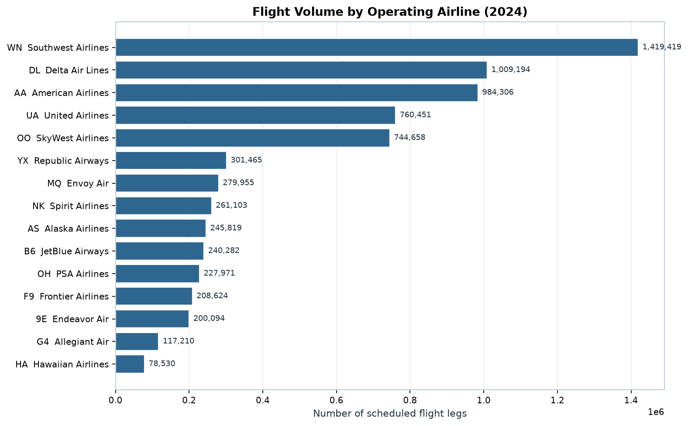
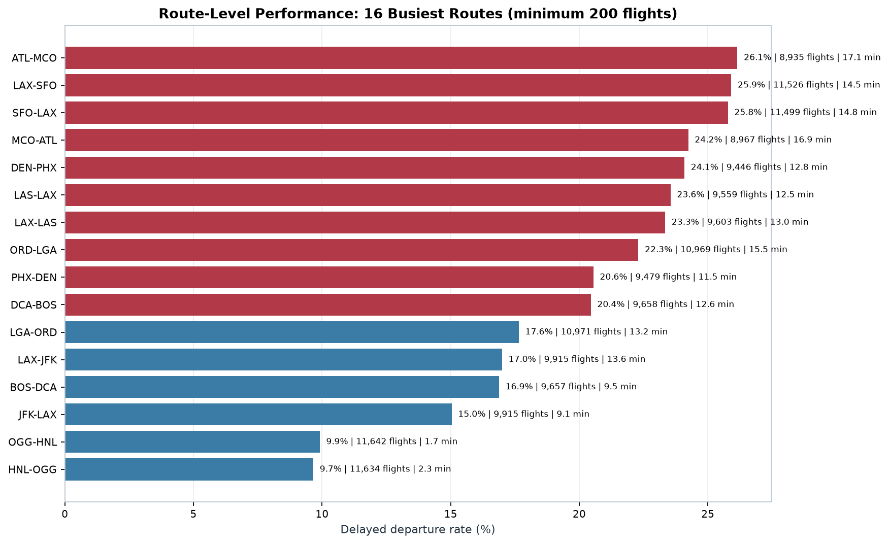
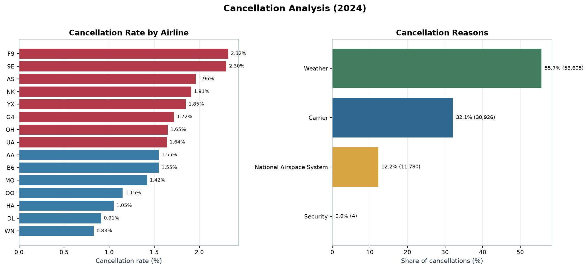
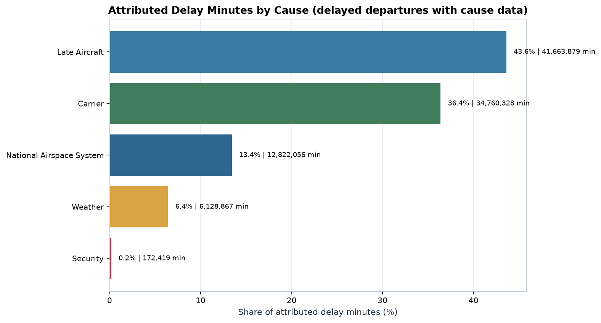
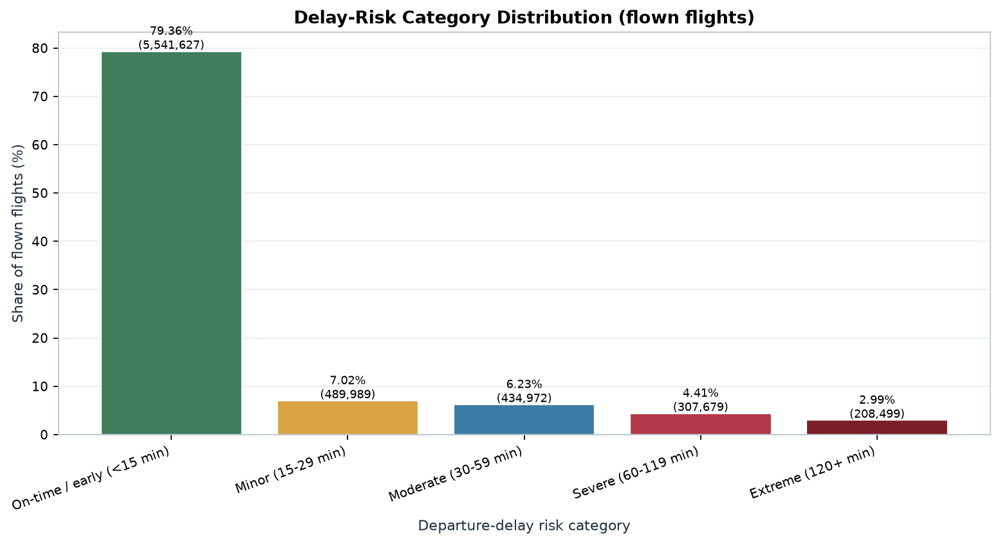

# Results and Discussion

## Executive summary

The 2024 file contains 7,079,081 flight records covering 366 days, 15 operating
carriers, 348 origin airports, 348 destination airports, and 6,805 routes. Of
these, 96,315 flights were cancelled (1.3606%) and 17,499 were diverted
(0.2472%). Among the 6,982,766 flown (non-cancelled) flights, 1,441,139
departures were delayed by at least 15 minutes (20.6385%).

The delay distribution is strongly right-skewed. The mean departure delay is
12.6451 minutes, but the median is -2 minutes, meaning more than half of flown
flights leave early or on time. The 90th percentile is 44 minutes and the 99th
percentile is 216 minutes (3.6 hours), so a relatively small tail accounts for a
large share of total delay minutes.

Key patterns:

- July is the busiest month (634,613 flights) and has the highest delayed-
  departure rate (29.49%).
- Friday and Sunday have the highest delayed-departure rates (22.98% and 22.74%).
- Delay risk rises through the day: 06:00 has a 7.68% delayed rate, while 20:00
  has 32.05%.
- Among airlines with at least 10,000 flights, F9 has the highest delayed-
  departure rate (27.68%) and YX the lowest (11.68%).
- Weather accounts for 55.66% of cancellations; carrier reasons account for
  32.11%, and National Airspace System reasons for 12.23%.
- Late aircraft (43.61%) and carrier (36.38%) account for 79.99% of attributed
  delay minutes.
- The logistic-regression model reaches AUC 0.6884 and F1 0.4202, capturing
  67.02% of delayed flights at 30.60% precision on a random hold-out set.

## Overall scale

| KPI | Value |
|---|---:|
| Total flight records | 7,079,081 |
| Cancelled flights | 96,315 |
| Cancellation rate | 1.3606% |
| Diverted flights | 17,499 |
| Diversion rate | 0.2472% |
| Flown (not cancelled) | 6,982,766 |
| Delayed departures (>= 15 min) | 1,441,139 |
| Delayed-departure rate | 20.6385% |
| Delayed arrivals (>= 15 min) | 1,449,972 |
| Delayed-arrival rate | 20.8172% |
| Mean departure delay | 12.6451 min |
| Median departure delay | -2.00 min |
| P90 departure delay | 44 min |
| P99 departure delay | 216 min |
| Mean arrival delay | 7.0982 min |
| Median arrival delay | -6.00 min |
| P90 arrival delay | 43 min |
| Mean distance | 834.2 mi |

The gap between mean and median departure delay is the central descriptive
finding: most flights are early or close to schedule, while a minority experience
long delays. Reporting only the mean would overstate the typical passenger's
experience; reporting only the median would hide the operational tail. Both are
needed.

Arrival delays are lower than departure delays on average (7.10 vs 12.65
minutes), which is consistent with schedule padding and en-route recovery, but
the data are observational and cannot prove that mechanism.

## Airline results

Rates are based on airlines with at least 10,000 flights. All 15 carriers meet
this threshold.

| Carrier | Airline | Flights | Delayed dep % | Mean dep (min) | Median dep (min) | P90 dep (min) | Delayed arr % | Cancellation % |
|---|---|---:|---:|---:|---:|---:|---:|---:|
| F9 | Frontier Airlines | 208,624 | 27.68 | 18.95 | -2 | 67 | 28.74 | 2.32 |
| B6 | JetBlue Airways | 240,282 | 25.79 | 17.40 | -2 | 65 | 25.51 | 1.55 |
| AA | American Airlines | 984,306 | 25.59 | 20.65 | -1 | 63 | 26.13 | 1.55 |
| NK | Spirit Airlines | 261,103 | 24.96 | 14.92 | -2 | 56 | 23.93 | 1.91 |
| WN | Southwest Airlines | 1,419,419 | 23.37 | 11.74 | 0 | 39 | 20.60 | 0.83 |
| G4 | Allegiant Air | 117,210 | 21.24 | 14.04 | -5 | 49 | 21.67 | 1.72 |
| AS | Alaska Airlines | 245,819 | 20.11 | 7.61 | -2 | 35 | 22.07 | 1.96 |
| OH | PSA Airlines | 227,971 | 19.77 | 13.87 | -4 | 50 | 21.77 | 1.65 |
| UA | United Airlines | 760,451 | 19.00 | 11.91 | -3 | 44 | 19.86 | 1.64 |
| MQ | Envoy Air | 279,955 | 18.75 | 10.14 | -2 | 38 | 20.86 | 1.42 |
| DL | Delta Air Lines | 1,009,194 | 17.16 | 10.21 | -2 | 34 | 17.26 | 0.91 |
| OO | SkyWest Airlines | 744,658 | 17.15 | 11.27 | -4 | 41 | 19.00 | 1.15 |
| 9E | Endeavor Air | 200,094 | 14.88 | 8.28 | -5 | 32 | 15.83 | 2.30 |
| HA | Hawaiian Airlines | 78,530 | 13.31 | 5.46 | -1 | 20 | 15.45 | 1.05 |
| YX | Republic Airways | 301,465 | 11.68 | 3.91 | -5 | 21 | 14.07 | 1.85 |

F9, B6, AA, NK, and WN form the highest-delay group at 23.37–27.68%. YX, HA,
9E, OO, and DL form the lowest-delay group at 11.68–17.16%. The spread is
material: the highest rate is 2.37 times the lowest.

Airline rankings should be read with care. They mix network geography, hub
congestion, scheduled block time, aircraft routing, and passenger mix. The
dataset does not include those explanatory variables. The ranking is descriptive,
not a measure of managerial quality.

## Temporal patterns

### Monthly

| Month | Flights | Cancelled | Cancel % | Mean dep (min) | Median dep (min) | P90 dep (min) | Delayed dep % | Mean arr (min) |
|---|---:|---:|---:|---:|---:|---:|---:|---:|
| January | 547,271 | 20,389 | 3.73 | 15.62 | -2 | 51 | 23.14 | 10.35 |
| February | 519,221 | 3,002 | 0.58 | 7.44 | -3 | 28 | 15.49 | 0.59 |
| March | 591,767 | 5,120 | 0.87 | 12.43 | -2 | 43 | 20.83 | 6.50 |
| April | 582,205 | 4,035 | 0.69 | 10.79 | -2 | 38 | 18.89 | 5.36 |
| May | 609,743 | 8,244 | 1.35 | 18.06 | -1 | 60 | 25.64 | 14.05 |
| June | 611,132 | 7,876 | 1.29 | 16.90 | -1 | 55 | 25.31 | 11.81 |
| July | 634,613 | 18,372 | 2.89 | 22.30 | 0 | 72 | 29.49 | 18.09 |
| August | 619,025 | 12,714 | 2.05 | 15.25 | -2 | 52 | 23.03 | 10.59 |
| September | 582,622 | 3,499 | 0.60 | 6.64 | -3 | 27 | 15.07 | 1.00 |
| October | 615,497 | 6,284 | 1.02 | 5.44 | -3 | 23 | 13.60 | -1.28 |
| November | 575,404 | 2,629 | 0.46 | 6.21 | -3 | 26 | 14.41 | -0.32 |
| December | 590,581 | 4,151 | 0.70 | 13.53 | -1 | 45 | 21.63 | 7.12 |

July is the busiest month and the most delayed: 634,613 flights, 22.30-minute
mean departure delay, 29.49% delayed departures, and a 2.89% cancellation rate.
October is the least delayed (13.60% delayed; 5.44-minute mean). January has the
highest cancellation rate (3.73%), driven by 20,389 cancellations; November has
the lowest (0.46%).

Weather is the largest overall cancellation reason (55.66%), and January's
cancellation peak is consistent with winter disruption. This is an association
from the supplied data, not a flight-level weather attribution.

### Day of week

| Day | Flights | Mean dep (min) | Delayed dep % | Cancel % |
|---|---:|---:|---:|---:|
| Monday | 1,073,959 | 12.70 | 20.60 | 1.37 |
| Tuesday | 976,073 | 10.43 | 17.70 | 1.28 |
| Wednesday | 973,179 | 10.38 | 18.09 | 1.25 |
| Thursday | 1,041,956 | 13.13 | 21.35 | 1.45 |
| Friday | 1,055,419 | 14.63 | 22.98 | 1.52 |
| Saturday | 911,515 | 12.56 | 20.63 | 1.20 |
| Sunday | 1,046,980 | 14.36 | 22.74 | 1.43 |

Friday has the highest delayed-departure rate (22.98%) and cancellation rate
(1.52%). Tuesday has the lowest delayed rate (17.70%), while Saturday has the
lowest cancellation rate (1.20%). The day-of-week spread is real but modest
compared with the hour-of-day spread.

### Scheduled departure hour

| Hour | Flights | Mean dep (min) | Delayed dep % | Cancel % |
|---:|---:|---:|---:|---:|
| 0 | 12,331 | 15.51 | 24.75 | 1.62 |
| 1 | 4,077 | 14.66 | 22.04 | 1.74 |
| 2 | 1,543 | 11.11 | 25.10 | 1.88 |
| 3 | 1,093 | 9.84 | 21.98 | 2.20 |
| 4 | 534 | 16.36 | 22.24 | 1.50 |
| 5 | 200,157 | 5.17 | 7.83 | 1.32 |
| 6 | 495,017 | 3.99 | 7.68 | 1.27 |
| 7 | 493,915 | 4.90 | 9.81 | 1.21 |
| 8 | 482,402 | 5.79 | 11.97 | 1.07 |
| 9 | 395,739 | 7.20 | 14.17 | 1.07 |
| 10 | 439,299 | 8.67 | 16.44 | 1.07 |
| 11 | 442,008 | 9.89 | 17.91 | 1.02 |
| 12 | 419,882 | 11.43 | 19.58 | 1.15 |
| 13 | 423,120 | 12.88 | 21.55 | 1.14 |
| 14 | 406,552 | 14.54 | 23.69 | 1.30 |
| 15 | 407,710 | 15.85 | 25.45 | 1.31 |
| 16 | 409,197 | 17.29 | 26.90 | 1.51 |
| 17 | 443,706 | 17.98 | 27.29 | 1.58 |
| 18 | 435,133 | 19.78 | 29.57 | 1.73 |
| 19 | 387,894 | 20.73 | 31.05 | 1.81 |
| 20 | 317,614 | 21.29 | 32.05 | 1.83 |
| 21 | 235,114 | 20.38 | 30.49 | 1.79 |
| 22 | 166,351 | 19.82 | 29.24 | 2.01 |
| 23 | 58,692 | 15.40 | 24.50 | 1.83 |

The early-morning window is the most reliable. At 06:00, only 7.68% of flights
are delayed and the mean delay is 3.99 minutes. By 20:00, 32.05% are delayed and
the mean is 21.29 minutes. The pattern is consistent with delay accumulation
through the operating day, but it is descriptive; crew, aircraft, and airport
constraints are not observed.

The late-night hours (0–4) have high delay rates but small volume: together they
account for 19,578 flights, about 0.28% of the file. Rates for those hours should
be interpreted with that sample size in mind.

## Airport results

### Busiest origin airports

| Airport | City | Flights | Destinations | Cancel % | Mean dep (min) | Median dep (min) | P90 dep (min) | Delayed dep % |
|---|---|---:|---:|---:|---:|---:|---:|---:|
| ATL | Atlanta, GA | 341,910 | 157 | 1.00 | 11.08 | -2 | 38 | 19.74 |
| DFW | Dallas/Fort Worth, TX | 313,582 | 186 | 1.86 | 18.89 | -1 | 62 | 27.50 |
| DEN | Denver, CO | 308,645 | 180 | 1.13 | 13.24 | -1 | 46 | 23.17 |
| ORD | Chicago, IL | 280,052 | 163 | 1.35 | 15.20 | -2 | 53 | 22.15 |
| CLT | Charlotte, NC | 217,574 | 132 | 1.37 | 18.39 | -1 | 61 | 26.44 |
| LAX | Los Angeles, CA | 194,053 | 112 | 0.81 | 10.25 | -2 | 36 | 18.03 |
| PHX | Phoenix, AZ | 193,551 | 110 | 0.61 | 10.94 | -1 | 39 | 20.07 |
| LAS | Las Vegas, NV | 189,252 | 132 | 0.88 | 12.86 | -1 | 45 | 23.54 |
| SEA | Seattle, WA | 163,725 | 92 | 1.11 | 9.53 | -1 | 35 | 20.55 |
| LGA | New York, NY | 162,432 | 86 | 2.37 | 10.61 | -4 | 42 | 17.96 |

ATL is the largest origin (341,910 flights), followed by DFW (313,582) and DEN
(308,645). The busiest airport is not the most delayed: ATL's delayed rate is
19.74%, while DFW's is 27.50% and CLT's is 26.44%. This is why volume and delay
must be analyzed jointly.

### Highest and lowest delayed-departure rates

Among airports with at least 10,000 flights:

| Group | Airport | City | Flights | Delayed dep % | Mean dep (min) |
|---|---|---|---:|---:|---:|
| Highest | BWI | Baltimore, MD | 98,572 | 28.57 | 15.32 |
| Highest | DFW | Dallas/Fort Worth, TX | 313,582 | 27.50 | 18.89 |
| Highest | FLL | Fort Lauderdale, FL | 91,890 | 27.17 | 17.19 |
| Highest | MIA | Miami, FL | 109,944 | 27.12 | 19.55 |
| Highest | CLT | Charlotte, NC | 217,574 | 26.44 | 18.39 |
| Lowest | KOA | Kona, HI | 16,327 | 11.24 | 4.47 |
| Lowest | LIH | Lihue, HI | 15,957 | 11.27 | 3.45 |
| Lowest | OGG | Kahului, HI | 26,543 | 11.70 | 3.86 |
| Lowest | HNL | Honolulu, HI | 61,548 | 13.73 | 5.80 |
| Lowest | GEG | Spokane, WA | 17,527 | 13.88 | 6.58 |

The highest rates are at BWI, DFW, FLL, MIA, and CLT. The lowest are at Hawaii
airports and GEG. Geography, weather exposure, carrier mix, and network structure
all differ across these airports; the dataset itself does not isolate those
effects.

### Highest cancellation rates

| Airport | City | Flights | Cancel % |
|---|---|---:|---:|
| SRQ | Sarasota/Bradenton, FL | 16,201 | 3.52 |
| AVL | Asheville, NC | 12,082 | 3.12 |
| TPA | Tampa, FL | 78,517 | 2.53 |
| EWR | Newark, NJ | 128,979 | 2.52 |
| LGA | New York, NY | 162,432 | 2.37 |
| RSW | Fort Myers, FL | 34,871 | 2.30 |
| BUF | Buffalo, NY | 22,166 | 2.22 |
| PWM | Portland, ME | 11,674 | 2.16 |

The cancellation list is dominated by Florida and Northeast airports, which is
consistent with weather and airspace disruption, but the file does not include
airport-level weather measurements.

## Route results

### Busiest routes

| Route | Distance (mi) | Flights | Mean dep (min) | Median dep (min) | P90 dep (min) | Delayed dep % | Cancel % |
|---|---:|---:|---:|---:|---:|---:|---:|
| OGG-HNL | 100 | 11,642 | 1.72 | -3 | 14 | 9.91 | 1.10 |
| HNL-OGG | 100 | 11,634 | 2.27 | -2 | 14 | 9.66 | 0.95 |
| LAX-SFO | 337 | 11,526 | 14.48 | -2 | 56 | 25.91 | 0.90 |
| SFO-LAX | 337 | 11,499 | 14.75 | -1 | 53 | 25.78 | 1.01 |
| LGA-ORD | 733 | 10,971 | 13.16 | -4 | 48 | 17.65 | 2.22 |
| ORD-LGA | 733 | 10,969 | 15.52 | -3 | 57 | 22.30 | 2.06 |
| LAX-JFK | 2,475 | 9,915 | 13.56 | -3 | 38 | 17.00 | 0.44 |
| JFK-LAX | 2,475 | 9,915 | 9.11 | -3 | 29 | 15.04 | 0.39 |
| DCA-BOS | 399 | 9,658 | 12.64 | -5 | 53 | 20.45 | 1.65 |
| BOS-DCA | 399 | 9,657 | 9.50 | -5 | 40 | 16.88 | 1.58 |

The busiest route pair is the short Hawaii inter-island link (OGG-HNL and
HNL-OGG), with about 11,600 flights each and delayed rates below 10%. The
LAX-SFO pair is similarly busy but has delayed rates near 26%. Route-level
operations differ sharply even at comparable volume.

### Highest and lowest delayed rates among routes with >= 500 flights

| Group | Route | Distance (mi) | Flights | Mean dep (min) | Delayed dep % | Cancel % |
|---|---|---:|---:|---:|---:|---:|
| Highest | BDL-SJU | 1,666 | 1,000 | 33.99 | 44.55 | 1.90 |
| Highest | EYW-DFW | 1,089 | 541 | 55.17 | 44.00 | 2.96 |
| Highest | DFW-CAE | 922 | 728 | 42.85 | 42.60 | 2.61 |
| Highest | DFW-GEG | 1,477 | 686 | 40.53 | 42.50 | 0.87 |
| Highest | DFW-BDL | 1,471 | 590 | 26.11 | 41.84 | 2.37 |
| Lowest | OGG-PHX | 2,845 | 829 | 2.49 | 3.99 | 0.24 |
| Lowest | PIH-SLC | 150 | 700 | -3.08 | 4.71 | 0.00 |
| Lowest | HLN-SLC | 402 | 734 | 0.58 | 5.19 | 0.27 |
| Lowest | SDF-IAD | 451 | 564 | -2.56 | 5.68 | 0.18 |
| Lowest | BTM-SLC | 358 | 690 | -4.98 | 5.80 | 0.00 |

### Highest cancellation rates among routes with >= 500 flights

| Route | Distance (mi) | Flights | Delayed dep % | Cancel % |
|---|---:|---:|---:|---:|
| ASE-IAH | 913 | 661 | 38.03 | 7.72 |
| ASE-LAX | 737 | 1,169 | 28.19 | 6.84 |
| ASE-ORD | 1,013 | 996 | 34.16 | 6.53 |
| ASE-DFW | 701 | 1,162 | 27.55 | 6.28 |
| ASE-DEN | 125 | 2,852 | 26.45 | 6.14 |
| IAH-ASE | 913 | 661 | 29.42 | 5.90 |
| DEN-ASE | 125 | 2,848 | 25.42 | 5.79 |
| EWR-AVL | 583 | 629 | 12.98 | 5.72 |
| AVL-EWR | 583 | 629 | 18.21 | 5.72 |
| EWR-BGR | 393 | 681 | 14.62 | 5.58 |

Aspen (ASE) routes dominate the high-cancellation list, and ASE also appears in
high-delay routes. Mountain-airport weather and terrain are plausible
explanations, but those variables are not in the dataset. The pattern is a
prioritisation signal for further investigation, not a proven cause.

## Cancellations

### Overall reasons

| Reason | Cancellations | Share |
|---|---:|---:|
| Weather | 53,605 | 55.66% |
| Carrier | 30,926 | 32.11% |
| National Airspace System | 11,780 | 12.23% |
| Security | 4 | <0.01% |
| **Total** | **96,315** | **100%** |

Weather is the largest cancellation reason, followed by carrier and airspace.
Security cancellations are negligible in this file (four flights).

### By airline

| Carrier | Cancelled | Cancel % | Carrier reason | Weather | NAS | Security |
|---|---:|---:|---:|---:|---:|---:|
| F9 | 4,835 | 2.32 | 2,234 | 2,601 | 0 | 0 |
| 9E | 4,608 | 2.30 | 1,209 | 1,085 | 2,314 | 0 |
| AS | 4,811 | 1.96 | 4,016 | 785 | 10 | 0 |
| NK | 4,998 | 1.91 | 872 | 3,801 | 323 | 2 |
| YX | 5,576 | 1.85 | 609 | 2,862 | 2,105 | 0 |
| G4 | 2,018 | 1.72 | 751 | 964 | 303 | 0 |
| OH | 3,751 | 1.65 | 383 | 3,250 | 118 | 0 |
| UA | 12,478 | 1.64 | 8,159 | 2,794 | 1,525 | 0 |
| AA | 15,252 | 1.55 | 1,986 | 12,899 | 367 | 0 |
| B6 | 3,735 | 1.55 | 774 | 1,217 | 1,744 | 0 |
| MQ | 3,985 | 1.42 | 341 | 2,692 | 952 | 0 |
| OO | 8,527 | 1.15 | 122 | 7,707 | 696 | 2 |
| HA | 822 | 1.05 | 727 | 95 | 0 | 0 |
| DL | 9,147 | 0.91 | 6,559 | 2,451 | 137 | 0 |
| WN | 11,772 | 0.83 | 2,184 | 8,402 | 1,186 | 0 |

F9 and 9E have the highest cancellation rates (2.32% and 2.30%), while WN and DL
have the lowest (0.83% and 0.91%). The reason mix differs: 9E's cancellations are
mostly NAS-attributed, AS and DL are mostly carrier-attributed, and WN, OO, AA,
and OH are mostly weather-attributed. The reason field is supplied by the
carrier/airspace system and should be treated as attribution, not independent
verification.

## Delay causes

Cause shares use 1,155,299 delayed departures with positive attributed minutes.
This is 80.1657% of the 1,441,139 delayed departures. The remaining 285,840
delayed departures have no positive cause attribution and are not treated as zero
cause.

| Cause | Attributed minutes | Flights with cause | Share of minutes |
|---|---:|---:|---:|
| Late Aircraft | 41,663,879 | 703,105 | 43.61% |
| Carrier | 34,760,328 | 695,667 | 36.38% |
| National Airspace System | 12,822,056 | 449,956 | 13.42% |
| Weather | 6,128,867 | 81,418 | 6.41% |
| Security | 172,419 | 6,478 | 0.18% |
| **Total** | **95,547,549** | | **100%** |

Late aircraft and carrier causes together account for 79.99% of attributed
minutes. This is consistent with delay propagation through aircraft rotations and
carrier-controlled processes, but the cause columns are BTS attributions, not a
controlled causal experiment. Weather has a much larger share of cancellations
(55.66%) than of attributed delay minutes (6.41%), which highlights that
cancellation and delay are different operational outcomes.

## Delay-risk distribution

| Risk band | Flights | Share | Mean dep (min) | P90 dep (min) |
|---|---:|---:|---:|---:|
| On-time / early (<15) | 5,541,627 | 79.3615% | -2.87 | 6 |
| Minor (15–29) | 489,989 | 7.0171% | 21.12 | 27 |
| Moderate (30–59) | 434,972 | 6.2292% | 42.23 | 55 |
| Severe (60–119) | 307,679 | 4.4063% | 83.67 | 109 |
| Extreme (120+) | 208,499 | 2.9859% | 238.62 | 389 |

About 79.36% of flown flights are on time or early. The severe and extreme bands
contain 516,178 flights (7.39%) but have mean delays of 83.67 and 238.62 minutes,
so they contribute disproportionately to total delay exposure.

## Distance bands

| Distance band | Flights | Average distance (mi) | Mean dep (min) | Delayed dep % | Cancel % |
|---|---:|---:|---:|---:|---:|
| <250 mi | 802,935 | 175.9 | 10.96 | 18.21 | 1.53 |
| 250–499 mi | 1,614,684 | 373.4 | 11.19 | 19.42 | 1.27 |
| 500–999 mi | 2,595,767 | 734.9 | 12.94 | 21.03 | 1.41 |
| 1,000–1,499 mi | 1,150,993 | 1,188.3 | 14.50 | 22.57 | 1.42 |
| 1,500+ mi | 914,702 | 2,059.5 | 13.52 | 21.37 | 1.18 |

Delayed-departure rates rise from 18.21% on the shortest band to 22.57% on
1,000–1,499-mile flights, then fall slightly to 21.37% for 1,500+ miles.
Cancellation rates are highest on the shortest band (1.53%) and lowest on the
longest (1.18%). The relationship is not strictly monotonic, so distance alone is
not a sufficient explanation.

## Volume–delay association

| Group level | Groups | Pearson r | p-value |
|---|---:|---:|---:|
| Airline | 15 | 0.1594 | 0.5705 |
| Origin airport | 101 | 0.5169 | 0.0000 |

The airport-level association is moderate and statistically significant at the
reported precision: busier airports tend to have higher delayed-departure rates.
The airline-level association is weak and not statistically significant. These
are group-level correlations; they do not show that adding flights causes delays.

## Extreme-delay sensitivity

| Variant | Flights | Mean (min) | Median (min) | P99 (min) |
|---|---:|---:|---:|---:|
| All observed delays | 6,982,766 | 12.6451 | -2.00 | 216 |
| Excluding > 24 h | 6,982,205 | 12.5042 | -2.00 | 215 |
| Excluding > 12 h | 6,975,091 | 11.5368 | -2.00 | 205 |

The mean changes by only 0.14 minutes when >24-hour delays are removed and by
1.11 minutes when >12-hour delays are removed. The median is unchanged. The
overall conclusion is robust to the extreme tail, although the tail matters for
passenger impact and for P99 reporting.

## Delay prediction

The Spark MLlib logistic-regression model uses only pre-outcome features:
carrier, origin, destination, month, day of week, scheduled departure hour,
distance, and scheduled elapsed time. It excludes actual delay values and cause
fields to prevent leakage.

| Model | Accuracy | Precision | Recall | F1 | AUC |
|---|---:|---:|---:|---:|---:|
| Majority baseline | 0.7935 | 0.0000 | 0.0000 | 0.0000 | 0.5000 |
| Logistic regression | 0.6180 | 0.3060 | 0.6702 | 0.4202 | 0.6884 |

The model captures 193,317 of 288,443 delayed hold-out flights (recall 67.02%) but
also flags 438,423 on-time flights (precision 30.60%). It predicts 45.2% of
hold-out flights as delayed because class-balanced weights were used. The
majority baseline is 79.35% accurate only because it never predicts a delay; its
delayed-class F1 is zero. Accuracy alone is therefore misleading for this task.

## Discussion

### What the results show

1. **The delay problem is a tail problem.** The median flight is early by two
   minutes, but the mean is 12.65 minutes and the P99 is 216 minutes. Operational
   and passenger-impact metrics should report both central tendency and tail
   risk.
2. **Time of day is a strong descriptive signal.** Delayed rates rise from 7.68%
   at 06:00 to 32.05% at 20:00. This is the clearest scheduling pattern in the
   data. It is consistent with delay propagation, but the data cannot separate
   propagation from airport congestion, crew scheduling, or weather.
3. **Airport and route context matter.** Busy airports are not uniformly worse;
   ATL has 341,910 flights and a 19.74% delayed rate, while DFW has 313,582
   flights and 27.50%. Route-level differences are even larger (3.99% to 44.55%
   among routes with at least 500 flights). Aggregating only at the national level
   hides actionable variation.
4. **Airline rankings are descriptive.** F9 has the highest delayed rate (27.68%)
   and YX the lowest (11.68%), but network and scheduling differences are not
   controlled. The ranking is a starting point for drill-down, not a causal
   performance scorecard.
5. **Cancellation and delay have different cause profiles.** Weather dominates
   cancellations (55.66%) but only 6.41% of attributed delay minutes. Late
   aircraft and carrier causes dominate attributed delay minutes (79.99%).
   Treating "disruption" as one metric would obscure this difference.
6. **Prediction is feasible but moderate.** AUC 0.6884 is useful for screening,
   not for high-stakes individual decisions. The model's recall-oriented
   trade-off is appropriate when missing a delay is costlier than a false alarm,
   but that cost assumption must be made explicit.

### Practical implications

- Monitor the late-afternoon and evening bank (16:00–22:00) for delay
  accumulation and schedule recovery.
- Investigate airports and routes with both high volume and high delay, rather
  than ranking on delay rate alone.
- Separate cancellation planning from delay planning: weather drives
  cancellations, while late aircraft and carrier processes drive attributed delay
  minutes.
- Use the model as a triage tool with a threshold chosen from operational costs,
  not as an automatic decision rule.
- Report cause coverage explicitly; 19.83% of delayed departures lack positive
  cause attribution.

### Limitations

- One year of data (2024); seasonal patterns may not generalize.
- No weather, crew, maintenance, passenger, or airport-capacity variables.
- Cause fields are attributions, not independently verified causes.
- The ML split is random, not temporal; future-period performance is unknown.
- Local single-machine Spark (`local[8]`) with 6 GB; no cluster-scale benchmark.
- No causal identification strategy; all associations are descriptive.
- Extreme delays are retained; sensitivity analysis bounds their effect on the
  mean but does not remove them from operational reality.

## Conclusion

The 2024 dataset shows a system in which most flights are early or on time, but a
long tail of delays and a small set of cancellations create substantial
disruption. Delay risk is concentrated in the evening, in specific airports and
routes, and in the extreme tail. Weather dominates cancellations, while late
aircraft and carrier processes dominate attributed delay minutes. A leakage-safe
Spark MLlib model provides moderate screening value (AUC 0.6884, recall 67.02%)
but does not replace operational judgment. The results are reproducible from the
executed notebook and the exported tables in this folder.
